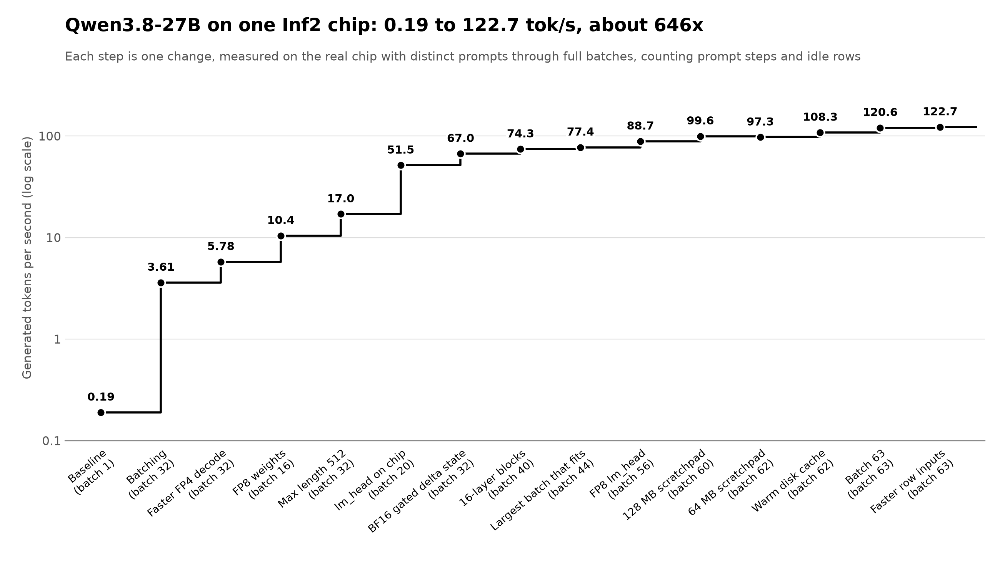

# Throughput log

**The goal is maximum throughput, not latency.** Time per token doesn't matter, so any trade that raises total tokens per second is worth making.

One change per row, each measured on the real chip with `scripts/batch_generate.py`.

**The benchmark:** `inf2.xlarge`, two full batches of distinct prompts (about 21 prompt tokens each), 32 new tokens per sequence, greedy. Row 0 runs the saved greedy prompt, and its output has to match, so a wrong graph can't look fast. From row 6, a saved 38-token passage also runs through every row first, and the top token must match the CPU's at each position.

**Generated tok/s** is the headline: tokens actually produced divided by wall time, including prompt steps and idle rows. **All tok/s** also counts prompt tokens processed. Nothing here is projected from a single step. Load time isn't included.

| # | Change | Batch | Chip s/step | Host s/step | Generated tok/s | All tok/s | Correct |
|---|---|---|---|---|---|---|---|
| 1 | Layout-optimized block, no batching | 1 | 3.75 | 0.13 | 0.19 | 0.26 | yes |
| 2 | Batching: all rows share one FP4 decode | 32 | 4.10 | 0.79 | 3.61 | 6.04 | yes |
| 3 | Faster decode: sign-free codes, integer mask instead of `floor`, no interleave | 32 | 2.25 | 0.81 | 5.78 | 9.66 | yes |
| 4 | No decode: FP8 weights read directly by a kernel (1.8x the weight memory, so fewer rows) | 16 | 0.21 | 0.68 | 10.43 | 17.29 | yes |
| 5 | Max sequence length 2048 cut to 512, so more rows fit | 32 | 0.24 | 0.80 | 17.03 | 28.49 | yes |
| 6 | `lm_head` on the chip, using 1.27 GB per core, so fewer rows | 20 | 0.18 | 0.04 | 51.48 | 85.74 | yes, 38 of 38 |
| 7 | Gated delta state in BF16, which halves the largest cost per row | 32 | 0.23 | 0.03 | 67.00 | 112.04 | yes, 38 of 38, see below |
| 8 | 16-layer blocks, so 4 loaded graphs instead of 16, which frees memory for rows | 40 | 0.24 | 0.05 | 74.29 | 124.58 | yes, 38 of 38 |
| 9 | Largest batch that fits this build. Batch 48 runs out of memory | 44 | 0.26 | 0.06 | 77.42 | 129.82 | yes, 38 of 38, see below |
| 10 | `lm_head` stored as FP8, which halves it, with the host rechecking the top 4 groups exactly | 56 | 0.29 | 0.07 | 88.72 | 148.92 | yes, 38 of 38, see below |
| 11 | Scratchpad pages of 128 MB instead of the runtime's default, which frees 256 MB per core | 60 | 0.30 | 0.03 | 99.64 | 167.39 | yes, 38 of 38, see below |
| 12 | Scratchpad pages of 64 MB, which fits two more rows. Not an improvement, because host time doubled | 62 | 0.29 | 0.06 | 97.29 | 163.49 | yes, 38 of 38 |
| 13 | Read lm_head and the embeddings into the disk cache after loading | 62 | 0.29 | 0.03 | 108.32 | 182.03 | yes, 38 of 38 |
| 14 | One more row, and the compiler's plan for this batch size is faster | 63 | 0.26 | 0.03 | 120.65 | 202.78 | yes, 38 of 38, see below |
| 15 | Build each row's inputs in one vectorized call | 63 | 0.26 | 0.02 | 122.67 | 206.18 | yes, 38 of 38, see below |
| 16 | Matmul inputs rounded to FP8 e5m2, so the Tensor Engine multiplies FP8 by FP8 with no weight cast, and weights read 2048 columns at a time | 63 | 0.20 | 0.02 | 156.20 | 262.54 | yes, 37 of 38 and 1 near tie, see below |

Rows 1 to 4 allow 2048 tokens of prompt plus output, and from row 5 it's 512. Batch 24 at 2048 ran out of chip memory.

Chip s/step counts the 16 blocks, and the chip part of `lm_head` counts as host time. In row 6, with every row generating, the run reached 81.2 tok/s over 13 steps.

Row 7 changes numbers, not just speed. Compared with row 6's build on the same prompts, 36 of 40 sequences are identical, and 1219 of 1280 tokens come before a sequence's first difference. Row 8 gives exactly the same comparison, but row 9 falls to 33 of 40 sequences and 1178 tokens, so batch size affects results as well as the BF16 state. Row 10 gives the same comparison as row 9, so FP8 lm_head with the host's recheck changed no token choices in those sequences. Greedy text can split at a near tie. On quality, `scripts/quality_check.py` runs 324 tokens of well-known English text through a build: BF16 state and float32 state both get the real next token at 315 of 323 positions (97.5%), and pick the same token at 323 of 324. Famous text is an easy test, so this rules out large damage rather than subtle damage. With every row generating, row 7 reached 110.0 tok/s over 14 steps.

Row 11's host time fell with no host code change, probably because the checkpoint's lm_head rows were already in the disk cache from earlier runs, so part of its gain isn't from the scratchpad. A long-running server would also see the warm number. With every row generating, row 11 reached 172.1 tok/s over 12 steps.

Row 13 reached 192.1 tok/s with every row generating, over 13 steps. A run at batch 60 with the same warm cache gave 101.01 generated tok/s and 0.30 s on the chip, so batch 62 really is faster per step there.

Row 15 reached 214.5 tok/s with every row generating, over 19 steps. At batch 63, the token comparison with the float32-state build is 31 of 40 identical sequences and 1135 of 1280 tokens before a first difference. The quality check there still gives 315 of 323, and the same top token as the float32-state build at all 324 positions.

Row 16 changes numbers: every matmul's input is rounded to FP8 e5m2, 2 mantissa bits with an exponent per value. The checkpoint was calibrated for MXFP4 activations, 1 mantissa bit with one exponent per 32 values, so this is still finer than its intended serving, and on a tiny model it gives under half the logit error of MXFP4 activations (`tests/test_model_parity.py`). The quality check gives 316 of 323 against 315 for row 15's build, with the same top token at 322 of 324 positions. Greedy text drifts more, because each near tie can flip: 30 of 126 sequences are identical to row 15's, and 2110 of 4032 tokens come before a first difference. Row 15's build, rerun in the same session on this instance, gave 123.23 generated tok/s, so the gain is 27%. With every row generating, row 16 reached 269.3 tok/s over 19 steps.

Raw results are in [throughput/](throughput/). `git log docs/throughput.md` gives the commit for each row.

## Agentic workload

The table above measures 21-token prompts with prompt plus output capped at 512 tokens, which no coding agent's request fits. From here the headline is `scripts/agentic_benchmark.py`: requests shaped like Claude Code turns, a system prompt with tools, a task, standard library files read back as tool results and a question about them. By default 16 requests from 8K to 30K prompt tokens run, plus the saved greedy prompt, with up to 256 new tokens each, greedy. It reports input, output and total tokens per second, all measured over the whole run. Two checks must pass: the saved greedy prompt gives its saved tokens, and the longest request recalls a key planted in its first file.

| # | Change | Rows x max length | Workload | Input tok/s | Output tok/s | Total tok/s | Correct |
|---|---|---|---|---|---|---|---|
| A1 | Prompts fed one token per decode step, as in row 16 | 2 x 32768 | 2 prompts of 4K | 24.03 | 0.41 | 24.45 | yes |
| A2 | Prefill graph: 512 prompt tokens of one row per call, with NKI kernels for the chunked gated delta rule and for flash attention over the cache | 2 x 32768 | 2 prompts of 4K | 400.65 | 6.90 | 407.55 | yes |
| A2 | Same build | 2 x 32768 | 16 prompts of 8K to 30K | 568.58 | 2.42 | 571.00 | yes, 114 requests per hour |
| A3 | Gated delta layers' conv, norms and gating fused into the prefill kernel | 2 x 32768 | 16 prompts of 8K to 30K | 711.59 | 2.54 | 714.12 | yes, 143 requests per hour |
| A3 | Same build | 2 x 32768 | 2 prompts of 4K | 458.68 | 6.54 | 465.22 | yes |
| A4 | The attention kernel takes 2048 cache positions per loop iteration instead of 512 | 2 x 32768 | 16 prompts of 8K to 30K | 781.05 | 3.87 | 784.93 | yes, 157 requests per hour |
| A4 | Same build | 2 x 32768 | 2 prompts of 4K | 498.07 | 8.57 | 506.64 | yes |
| A5 | The attention kernel's loop over cache blocks runs only as far as the chunk's start, a trip count read at run time | 2 x 32768 | 16 prompts of 8K to 30K | 879.80 | 4.36 | 884.10 | yes, 177 requests per hour |
| A5 | Same build | 2 x 32768 | 2 prompts of 4K | 570.50 | 9.82 | 580.32 | yes |

A1 and A2 are the same build, A1 run with `--no-prefill`. A1 on the full workload would take about 3.5 hours, so both ran the small one. Only 2 rows fit: a BF16 KV cache of 32K positions takes 1.07 GB per row on each core. The FP8 cache the checkpoint was calibrated for would fit about twice as many, but the compiler accepts FP8 only inside NKI kernels.

In A2 the full workload made 604 prefill calls and 760 decode steps in 536 s, so a 512-token chunk took about 0.79 s across the 4 blocks. One layer's prefill, timed alone on one core: gated delta 7.8 ms (21.9 ms as XLA ops), attention against a 32K cache 17.6 ms (36.8 ms with XLA scatters and a copy of the row), MLP 3.7 ms. The quality check gives 311 of 323 through decode and 313 of 323 through prefill, and the two paths pick the same top token at 319 of 324 positions.

In A3 everything in a gated delta layer's prefill between its input and output projections is one NKI kernel, so the causal conv, SiLU, query and key norms and the gated RMS norm no longer make round trips through HBM as XLA ops. One layer's prefill fell from 7.76 ms to 4.57 ms for 512 tokens. The quality check gives 315 of 323 through prefill, and 311 through decode.

In A4 the prefill attention kernel waits for each block's loads before computing it, so fewer, larger blocks hide more of that latency: one layer against a 32K cache takes 8.2 ms with 2048-position blocks, against 10.4 ms with 512 and 9.0 ms with 4096. The quality check is unchanged, 315 of 323 through prefill.

In A5 a chunk's attention visits only the cache blocks before its start: `range(scalar(n))` in NKI, with the SDK's `experimental-native-scalar-support` flag and middle-end transformations skipped, gives a device loop whose trip count is read from a tensor at run time. Before, every chunk scanned all 32K positions, so the first chunk of a prompt cost as much attention as the last. Alone on one core, the kernel takes 0.21 ms plus 0.59 ms per 2048 cached positions, against 8.2 ms for the full scan, so a 2048-position block costs about 19% more than in the static loop, and the full 32K scan would be 9.7 ms. On this workload a chunk visits about a third of the cache on average. The same 604 prefill calls and 797 decode steps took 346.6 s against 390.5 s. The quality check is unchanged, 315 of 323 through prefill and 311 through decode.

Output tokens are few in this workload: requests stop at the end of the answer, about 64 tokens each, and only 2 rows fit at 32K positions, so most of the time is prefill.

Raw results are in [throughput/agentic/](throughput/agentic/).

## Where the time goes

`neuron-profile` on one block at batch 32, before change 3 (0.268 s, core 0). Engines overlap, so these add to more than 100%:

| Engine | Busy |
|---|---|
| Vector | 74% |
| Scalar | 39% |
| GpSimd | 16% |
| Tensor (matmul) | 9.6% |
| DMA | 9.6% |
| Collectives | 1% |

To capture one, run with `NEURON_RT_INSPECT_ENABLE=1 NEURON_RT_INSPECT_DEVICE_PROFILE=1 NEURON_RT_INSPECT_OUTPUT_DIR=dir`, then `neuron-profile view -n dir/*/neff_<id>.neff -s dir/*/<id>_vnc_0.ntff --output-format summary-text`. The larger NEFF is the model, and the smaller one is the layout transformer.
